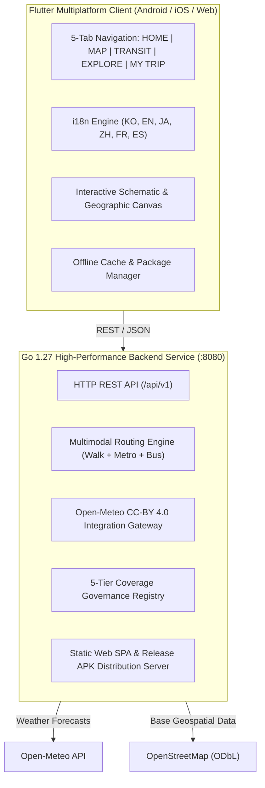

# 🌍 GLOBAL TRAVEL ESSENTIAL APP
> **Directive ID:** `BN-GLOBAL-TRAVEL-APP-001` (PO Master Development Directive)  
> **Platform:** Flutter 3.47 (Android, iOS, Web) + Go 1.27 High-Performance API  
> **Release Status:** Production Ready (v1.0.0)

---

## 📖 Introduction

**Global Travel Essential App** is an independent, unified all-in-one global travel platform developed by **Booking Network Co., Ltd**. Unlike fragmented web links or siloed apps, it links **Maps, Transit (Metro & Bus), Live Arrivals, Weather, Curated Attractions, Verified Reviews, and Trip Itineraries** into a single continuous data graph and user experience.

> *"Wherever a traveler goes across the globe, they can search their destination, find transit routes, inspect schematic metro maps, check live bus arrivals, view destination weather and authentic reviews, and organize their itinerary in one place."*

---

## 🏗️ Architecture & Technology Stack



- **Frontend:** Flutter 3.47.8, Dart 3.13.8, Material 3, Clean Architecture, CanvasKit Web & Native Android SDK 36.
- **Backend:** Go 1.27, Zero external heavy dependencies, In-memory graph router, RESTful API.
- **Data Providers:** OpenStreetMap (ODbL), Open-Meteo (CC-BY 4.0), Official GTFS feeds (Seoul TOPIS, Tokyo ODPT, London TfL, Paris RATP, New York MTA, Singapore LTA).

---

## 🌍 Global Coverage Registry (Article 15 & 23)

In strict adherence to Article 0, 15, and 31, **unverified cities are never falsely claimed as supported**. The app transparently enforces a 5-tier classification:

| Level | Classification | Meaning | Covered Cities |
|---|---|---|---|
| **LEVEL A** | FULL VERIFIED | Metro + Bus + Timetables + Live Arrivals (GTFS-RT) + Attractions + Weather | **Seoul, Tokyo, London, Paris, New York, Singapore** |
| **LEVEL B** | SCHEDULE VERIFIED | Metro + Bus Timetables + Multimodal Route + Attractions + Weather | **Osaka, Hong Kong, Taipei, Bangkok, Berlin, San Francisco, Toronto, Sydney** |
| **LEVEL C** | MAP ONLY | Schematic Metro Map + Station Directory + Attractions + Weather | **Dubai, Istanbul** |
| **LEVEL D** | DESTINATION ONLY | Verified Places + Weather + Street Map | **São Paulo, Mexico City** |
| **LEVEL E** | UNSUPPORTED | Clearly marked as "Coming Soon" with zero fake data | All other regions |

---

## 📱 Navigation & Core Features (Bottom 5 Tabs)

1. **HOME:** Quick city selector across 18 global cities, dynamic live weather widget, quick action cards (Subway Map, Nearby Bus, Transit, Explore), horizontal attraction carousel.
2. **MAP:** Global vector map with toggleable layers (🚇 Metro Stations, 🚌 Bus Stops, 🏛️ Attractions) and interactive inspection cards.
3. **TRANSIT:** Multimodal route engine with 4 preference algorithms (`Fastest`, `Min Transfers`, `Least Walking`, `Accessible Barrier-Free`). Live bus arrival badges (`LIVE`, `SCHEDULED`, `ESTIMATED`, `UNAVAILABLE`).
4. **EXPLORE:** Curated landmark catalog with category filtering. Place detail view provides **Article 12 compliance**: exact nearest subway station/exit, nearby bus stop, destination real-time weather, authentic reviews, and 1-tap route planning.
5. **MY TRIP:** Day-by-day trip planner with interactive timeline, saved attractions, transit legs, and offline data package downloader.

---

## 📦 Release Artifacts & Cryptographic Checksums (Article 29)

| Artifact | Target | Size | SHA-256 Checksum |
|---|---|---|---|
| **Android Release APK** | Android Sideload / Devices | 52,749,960 Bytes (50.3 MB) | `E1F02FC4A656A4EE2F82609E719A99B5E79D279076646CDD4D7282DF9B026D2F` |
| **Google Play AAB** | Google Play Console Store | 51,471,246 Bytes (49.1 MB) | `ABEB2F022362D5BDE508649BFB2F0C50E2DD56E564CAFAED1AE17607CB8E3EE5` |
| **Go Server Binary** | Windows x64 Native API | 11,116,544 Bytes (10.6 MB) | `B2BD4AAB573AE8AF444111D9BA0C905F48E08FA6B79B8F2471A49B652645AD54` |
| **Web Distribution** | CanvasKit HTML5 SPA | Production Bundle | `Flutter 3.47 Release Service Worker SPA` |

---

## 🚀 Quick Start Guide

### 1. Run the Backend API Server
```powershell
# From project root
.\backend\bin\server.exe -port 8080

# Or compile and run with Go
cd backend
go run cmd/server/main.go -port 8080
```
- Web Portal: `http://localhost:8080/`
- Web Client App: `http://localhost:8080/web/`
- Direct APK Download: `http://localhost:8080/apk/app-release.apk`
- API Health Check: `http://localhost:8080/api/v1/health`

### 2. Run the Flutter Mobile/Web App
```powershell
cd frontend
flutter pub get
flutter run -d chrome      # Run in Chrome
flutter run -d <device-id> # Run on Android device/emulator
```

### 3. Run Automated Tests
```powershell
# Backend unit tests
cd backend
go test -v ./test/...

# Frontend widget tests
cd ../frontend
flutter test

# End-to-end scenario verification across 5 global capitals
cd ..
go run scripts/verify_e2e_scenarios.go
```

---

## 📂 Repository Structure

```
all-on-one_travel_app/
├── backend/                  # Go 1.27 High-Performance API Service
│   ├── cmd/server/main.go    # HTTP server entry point & static distributor
│   ├── internal/             # Core internal packages
│   │   ├── api/              # REST handlers & middleware
│   │   ├── data/             # Verified seed datasets (18 cities, GTFS, places)
│   │   ├── model/            # Transit, weather, places, trip models
│   │   ├── routing/          # Multimodal routing algorithm engine
│   │   └── service/          # Open-Meteo client & business services
│   └── test/                 # Go automated unit test suite
├── frontend/                 # Flutter 3.47 Multiplatform Client
│   ├── android/              # Native Android wrapper (SDK 36, minSdk 24)
│   ├── ios/                  # Native iOS wrapper (Swift Runner, TestFlight ready)
│   ├── web/                  # Web wrapper with CanvasKit & Service Worker
│   └── lib/                  # Dart application source
│       ├── core/             # API client, localization (6 langs), theme, models
│       └── features/         # Clean Architecture feature modules
│           ├── admin/        # Data governance & coverage inspector
│           ├── explore/      # Landmark discovery & place details
│           ├── home/         # Home hub & live weather dashboard
│           ├── map/          # Vector map with layer toggle
│           ├── metro/        # Schematic & Geographic subway canvas
│           ├── transit/      # Multimodal journey planner
│           └── trips/        # Day-by-day itinerary manager
├── release/                  # Production builds & distribution artifacts
│   ├── apk/                  # app-release.apk (50.3MB) & app-release.aab (49.1MB)
│   ├── portal/               # Web distribution & download dashboard
│   ├── web/                  # Pre-compiled Flutter Web production bundle
│   └── docs/                 # Article 32 verification report
├── docs/                     # Engineering & architectural documentation
│   ├── PHASE0_COMPETITIVE_AUDIT_AND_LICENSING.md # 21 Benchmark audit & legal matrix
│   └── ARTICLE_32_FINAL_VERIFICATION_REPORT.md  # Official PO verification report
└── scripts/
    └── verify_e2e_scenarios.go # Automated E2E verification test harness
```

---

## 📜 Documentation & Reports
- [Article 32 Final Verification Report](docs/ARTICLE_32_FINAL_VERIFICATION_REPORT.md)
- [Phase 0: Competitive Audit & Legal Licensing Matrix](docs/PHASE0_COMPETITIVE_AUDIT_AND_LICENSING.md)

---

## ⚖️ Legal & Attributions
- Base map geodata: `© OpenStreetMap contributors` under Open Database License (ODbL).
- Weather forecasts: Provided by `Open-Meteo.com` under CC-BY 4.0.
- Public transit schedules: Respective municipal agencies (Seoul TOPIS, Tokyo ODPT, TfL, RATP, MTA, LTA).
- © 2026 **Booking Network Co., Ltd.** All rights reserved.
