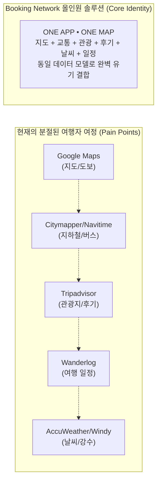
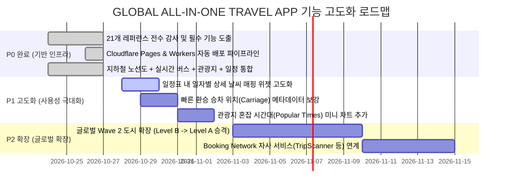

# 🌍 [BOOKING NETWORK CO., LTD]
# 21개 글로벌 레퍼런스 서비스 심층 전수조사 및 필수 구현 기능 분석 보고서
## GLOBAL ALL-IN-ONE TRAVEL ESSENTIAL APPLICATION
### 전 세계 지하철·버스·날씨·관광지·후기·길찾기·여행 일정 통합 플랫폼 개발 명령

---

- **문서 ID:** BN-AUDIT-2026-REF21
- **명령 출처:** PO Master Directive (BN-GLOBAL-TRAVEL-APP-001 & 002)
- **발행 일시:** 2026-10-27 17:30 (KST)
- **수행 에이전트:** Gemini 3.8 Flash High
- **조사 대상:** 글로벌 벤치마크 21개 플랫폼 전수
- **최종 승인권:** Booking Network Co., Ltd. 최고 PO

---

## 1. 전수조사 배경 및 핵심 목표

현재 글로벌 여행 시장에서 해외 여행자는 도시 한 곳을 여행할 때 최소 4~6개의 독립 애플리케이션을 번갈아 사용해야 하는 심각한 **사용자 경험의 분절(Fragmentation)**을 겪고 있습니다:



본 조사는 기 선정된 **21개 글로벌 벤치마킹 플랫폼**의 공식 인터페이스, 데이터 파이프라인, UX/UI 패턴, 장단점을 전수 분석하여, **우리 플랫폼이 반드시 구현해야 할 핵심 필수 기능(Must-Have Features)**을 도출하고 실제 개발 로드맵을 확정하는 데 목적이 있습니다.

---

## 2. 21개 글로벌 레퍼런스 플랫폼 심층 전수조사

### 2.1 대중교통 및 지하철 부문 (Platforms 1 ~ 11)

#### 1. Google Maps (구글 맵스)
- **분류:** 글로벌 범용 지도 및 길찾기
- **핵심 기능:** 전 세계 도로망, 대중교통 경로 탐색, 위성/스트리트뷰, 장소(POI) 데이터베이스.
- **화면 구조:** 하단 탐색/출퇴근/저장/참여 탭, 지도 중심 인터페이스, 실시간 교통 레이어.
- **장점:** 전 세계 압도적인 커버리지, 방대한 상점 및 관광지 영업시간/혼잡도 정보.
- **약점 및 한계:** 
  - 지하철 노선도(다이어그램/Schematic Map)가 별도로 제공되지 않고 지리적 궤적만 표시되어 복잡한 환승역 파악이 매우 어려움.
  - 일자별 여행 일정(Itinerary) 생성 기능이 없거나 내 지도(My Maps)로 분리되어 모바일에서 접근성 극도로 취약.
  - 완전한 오프라인 환경에서는 대중교통 경로 검색이 불가능함(차량/도보만 제한적 지원).

#### 2. Citymapper (시티매퍼)
- **분류:** 대도시 대중교통 특화 내비게이션
- **핵심 기능:** 복합 대중교통(지하철+버스+철도+공유자전거) 실시간 길찾기, 최적 승차 위치(Carriage recommendation), 출구 번호 안내, 실시간 환승 알림(Get Off Alerts).
- **화면 구조:** 심플한 초록 테마, 출발지/목적지 입력 시 소요시간·칼로리·비용별 다중 경로 카드.
- **장점:** 지하철 출구 번호와 승차 위치 안내가 세계 최고 수준이며, 실시간 지연 정보 반영이 뛰어남.
- **약점 및 한계:** 
  - 전 세계 약 80개 대도시권만 지원하여 중소도시나 신흥 여행지 커버 불가.
  - 관광지 상세 설명, 여행자 리뷰, 사진, 숙소/음식점 탐색 기능이 전무함.
  - 여행 일정 플래너 기능 없음.

#### 3. Moovit (무빗)
- **분류:** 글로벌 대중교통 길찾기 및 GTFS 허브
- **핵심 기능:** 전 세계 3,500+ 도시의 버스/지하철/트램 노선 및 시간표, 정류장 실시간 도착 알림.
- **화면 구조:** 방향 검색, 정류장 주변 탐색, 노선 목록.
- **장점:** 전 세계 가장 폭넓은 GTFS 대중교통 커버리지 보유.
- **약점 및 한계:** 
  - 무료 티어에서 전면 광고 및 배너 광고가 과도하여 여행 중 사용성 급격히 저하.
  - 관광/여행 콘텐츠가 전혀 없음.
  - UI가 기능 위주로 딱딱하며 노선도 그래픽 가독성이 떨어짐.

#### 4. Transit (트랜짓)
- **분류:** 실시간 로컬 대중교통 및 라이더 협업
- **핵심 기능:** 앱 실행 즉시 주변 버스/지하철 노선의 카운트다운 출발 시간 표시, 'GO' 실시간 내비게이션, 크라우드소싱 실시간 차량 위치 추적.
- **화면 구조:** 카드 기반 수직 스크롤, 미니멀 네온 컬러, 제스처 중심.
- **장점:** 실시간 버스 도착 시간 카운트다운의 직관성과 애니메이션이 매우 뛰어남.
- **약점 및 한계:** 
  - 거주자 통근(Commute)에 철저히 맞춰져 있어 해외 여행자용 관광지 연계 기능 없음.
  - 오프라인 여행 계획 기능 부재.
  - 북미/유럽 중심의 서비스 범위.

#### 5. Rome2Rio (롬투리오)
- **분류:** 국가 간 / 도시 간 장거리 복합 이동 검색
- **핵심 기능:** 항공편 + 고속철도 + 시외버스 + 페리 + 렌터카를 결합한 도시간 복합 경로 비교, 대략적 요금/소요시간 추정.
- **화면 구조:** 단일 검색창 기반의 간결한 인터페이스, 지도상의 거시적 이동 선 표시.
- **장점:** "파리에서 몽생미셸까지 어떻게 가나요?"와 같은 거시적 이동 경로 파악에 최고.
- **약점 및 한계:** 
  - 도시 내부의 세부 지하철 출구, 실시간 버스 도착 정보 등 라스트마일 이동에는 완전히 무용지물.
  - 티켓팅 외부 링크(스카이스캐너, 오미오 등) 중심의 메타검색으로 자체 앱 완결성 부족.

#### 6. Mapway (맵웨이 지하철 시리즈)
- **분류:** 단일 도시 지하철 노선도 앱 (런던 Tube Map, 뉴욕 Subway, 파리 Metro 등)
- **핵심 기능:** 도시별 공식 다이어그램 노선도 벡터 렌더링, 오프라인 노선도 확대/축소, 기본 역 간 경로 탐색.
- **화면 구조:** 풀스크린 노선도 캔버스, 하단 출발/도착 역 셀렉터.
- **장점:** 100% 오프라인에서 매끄러운 고해상도 노선도 렌더링, 복잡한 노선 체계의 시각적 안정감.
- **약점 및 한계:** 
  - 도시마다 별도의 앱(Tube Map, Paris Metro Map 등)을 따로 설치해야 하는 치명적 분절.
  - 버스 및 도보 통합 경로 탐색 불가.
  - 관광지 및 맛집 정보와의 연동 전무.

#### 7. Japan Travel by NAVITIME (네비타임 일본 여행)
- **분류:** 방일 외국인 전용 인바운드 통합 모빌리티
- **핵심 기능:** JR 패스 / 도쿄 서브웨이 티켓 전용 경로 필터, 지하철 노선도 탭, 환승 플랫폼 번호 안내, 무료 Wi-Fi 스팟 지도.
- **화면 구조:** 상단 교통/장소/일정/가이드 탭, 일본 특화 컬러풀 UI.
- **장점:** 외국인 여행자의 철도 패스 소지 여부에 따른 경로 분기, 지하철 노선도와 지리 지도의 즉각적인 전환.
- **약점 및 한계:** 
  - 일본 단일 국가에 한정됨.
  - 주요 편의 기능(오프라인 경로 검색, 상세 환승 안내)이 유료 구독(Premium) 뒤에 잠겨 있음.

#### 8. KakaoMap (카카오맵)
- **분류:** 대한민국 대중교통 및 지도 플랫폼
- **핵심 기능:** 초정밀 실시간 버스 위치(초단위 갱신), 지하철 승하차 빠른 환승 출구, 3D 스카이뷰, 테마 지도.
- **화면 구조:** 하단 검색/대중교통/MY, 우측 퀵 레이어 토글.
- **장점:** 실시간 버스 도착 시간의 정확도가 세계 최고 수준이며 지하철 승하차 위치 데이터가 정밀함.
- **약점 및 한계:** 
  - 대한민국 국내 전용 서비스.
  - 다국어(영어/중국어) 지원이 표면적이며 외국인이 영문으로 검색 시 매칭 실패율이 높음.

#### 9. Naver Map (네이버 지도)
- **분류:** 대한민국 대중교통 및 로컬 정보 플랫폼
- **핵심 기능:** 스마트어라운드(주변 맛집/관광지 추천), 실시간 버스/지하철 네비게이션, 예약 및 영수증 인증 리뷰.
- **화면 구조:** 상단 통합 검색바, 하단 내비/대중교통/주변/저장 탭.
- **장점:** 국내 최대의 로컬 장소 리뷰 및 사진 DB 보유, 대중교통 내비게이션 음성 안내.
- **약점 및 한계:** 
  - 글로벌 확장성 부재(국내 한정).
  - 계정 시스템이 네이버 회원 체계에 강하게 종속되어 해외 여행자의 접근 장벽 존재.

#### 10. HERE WeGo (히어 위고)
- **분류:** 글로벌 오프라인 벡터 내비게이션
- **핵심 기능:** 국가/도시 단위 전체 오프라인 지도 다운로드, 턴바이턴 차량/도보 내비게이션.
- **화면 구조:** 지도 중심 드라이브 모드, 깔끔한 다크모드.
- **장점:** 데이터 통신이 완전히 차단된 상태에서도 완벽한 벡터 지도 렌더링 및 자동차 길찾기 지원.
- **약점 및 한계:** 
  - 대중교통(지하철, 버스)의 정밀한 환승 및 실시간 시간표 지원이 대도시 외 지역에서 매우 부실.
  - 여행지 콘텐츠 및 여행 일정 관리 기능 부재.

#### 11. Organic Maps (오가닉 맵스)
- **분류:** 프라이버시 중심 100% 오프라인 OSM 지도
- **핵심 기능:** 광고/추적 없는 순수 오픈스트리트맵(OSM) 오프라인 렌더링, 하이킹/사이클링 등고선 트랙.
- **화면 구조:** 군더더기 없는 미니멀 지도 뷰, 배터리 절약형 고성능 렌더링.
- **장점:** 배터리 소모가 극히 적고 오프라인에서 POI 검색 및 도보 길찾기가 매우 안정적.
- **약점 및 한계:** 
  - 지하철 노선도 그래픽 부재.
  - 실시간 대중교통 및 시간표 정보 전혀 없음.
  - 사용자 리뷰, 영업시간, 실시간 정보가 매우 제한적.

---

### 2.2 여행지 및 관광 콘텐츠 부문 (Platforms 12 ~ 16)

#### 12. Tripadvisor (트립어드바이저)
- **분류:** 글로벌 여행자 리뷰 및 평가 플랫폼
- **핵심 기능:** 전 세계 관광지·식당·호텔 10억 건 이상의 리뷰 및 평점, 여행자 포럼, 트래블러스 초이스 순위.
- **화면 구조:** 피드형 홈, 검색, 트립(일정 저장), 마이페이지.
- **장점:** 전 세계 관광지의 압도적인 리뷰 축적량과 신뢰도 높은 사진 데이터.
- **약점 및 한계:** 
  - 리뷰를 본 후 해당 관광지까지 가는 지하철/버스 경로를 앱 내에서 직접 찾을 수 없음.
  - 광고 배너와 스폰서 제휴 상품이 지나치게 많아 탐색 피로도 증가.

#### 13. Google Travel / Places (구글 트래블)
- **분류:** 구글 생태계 통합 여행 탐색
- **핵심 기능:** 항공권/호텔 가격 추적, 날짜별 여행 가이드, 구글 지도 연동 저장소.
- **화면 구조:** 웹 중심의 미니멀 인터페이스, 카드형 추천.
- **장점:** 지메일 예약 확인서와의 자동 동기화, 방대한 빅데이터 기반 방문자 피크 시간대(Popular Times) 그래프.
- **약점 및 한계:** 
  - 독립된 네이티브 모바일 앱이 단종(Google Trips 종료)되어 웹 브라우저 또는 구글 맵스 내부에서 분절적으로 접근해야 함.
  - 오프라인 모드에서 일정을 한눈에 편집하기 어려움.

#### 14. Klook (클룩)
- **분류:** 글로벌 여행 액티비티 및 티켓 OTA
- **핵심 기능:** 전 세계 테마파크/어트랙션 입장권, 패스, 투어 모바일 바우처 즉시 발급.
- **화면 구조:** 이커머스형 쇼핑 인터페이스, 카테고리별 상품 딜.
- **장점:** 철도 패스 및 어트랙션 할인 티켓 인벤토리가 풍부함.
- **약점 및 한계:** 
  - 순수 커머스 앱으로, 티켓을 구매한 후 현장에서 목적지까지 이동하거나 일정을 유기적으로 관리하는 경험 결여.

#### 15. GetYourGuide (겟유어가이드)
- **분류:** 현지 투어 및 문화 체험 플랫폼
- **핵심 기능:** 공인 가이드 투어, 패스트트랙 입장권 예약, 모바일 오디오 가이드.
- **화면 구조:** 고해상도 큐레이션 이미지, 리뷰 중심 상세 페이지.
- **장점:** 투어의 품질 관리와 현장 집결지(Meeting Point) 지도 안내가 우수함.
- **약점 및 한계:** 
  - 도시 전반의 대중교통 체계나 일반 관광 일정과의 통합 부재.

#### 16. Lonely Planet (론리플래닛)
- **분류:** 클래식 여행 가이드북 및 큐레이션
- **핵심 기능:** 전문 여행 작가의 도시별 문화/역사적 배경 설명, 추천 도보 여행 코스.
- **화면 구조:** 매거진 스타일의 스토리텔링 레이아웃.
- **장점:** 상업적이지 않은 인문학적 깊이의 여행 정보 제공.
- **약점 및 한계:** 
  - 정적인 텍스트 위주로 실시간성(현재 날씨, 오늘 운행하는 버스, 실시간 영업 여부)이 떨어짐.

---

### 2.3 여행 일정 부문 (Platforms 17 ~ 18)

#### 17. Wanderlog (원더로그)
- **분류:** 지도 기반 협업 여행 일정 플래너
- **핵심 기능:** 지도와 일자별 타임라인의 분할 화면, 장소 간 이동 시간 및 거리 자동 산출, 일행과의 실시간 공동 편집.
- **화면 구조:** 데스크톱 2패널(좌측 타임라인, 우측 지도), 모바일 반응형 뷰.
- **장점:** 일정 순서에 따른 지도상의 넘버링 핀과 동선 시각화가 직관적임.
- **약점 및 한계:** 
  - 이동 경로 계산이 단순 직선 거리 또는 기본 구글 맵스 API에 의존하여, 현지의 정확한 지하철 환승 시간이나 버스 시간표가 반영되지 않음.
  - 오프라인 모드 및 핵심 최적화 기능이 고가의 유료 프로 플랜(Wanderlog Pro)에 묶여 있음.

#### 18. TripIt (트립잇)
- **분류:** 출장 및 여행 일정 자동 취합기
- **핵심 기능:** 항공권/호텔/렌터카 예약 확인 이메일 자동 포워딩 및 일정표 생성, 실시간 항공편 지연/탑승구 알림.
- **화면 구조:** 타임라인 리스트 중심의 비즈니스 룩.
- **장점:** 예약 메일 자동 파싱 및 캘린더 동기화 편의성 최고.
- **약점 및 한계:** 
  - 도시 내 관광지 탐색, 대중교통 이동, 도보 길찾기 기능이 완전히 결여되어 시티 투어에는 부적합.

---

### 2.4 날씨 부문 (Platforms 19 ~ 21)

#### 19. OpenWeather Services (오픈웨더)
- **분류:** 글로벌 표준 기상 API 서비스
- **핵심 기능:** 전 세계 좌표별 현재 기온, 풍속, 습도, 8일간의 일일 예보.
- **화면 구조:** 개발자 친화적 REST API 및 위젯.
- **장점:** 안정적인 글로벌 커버리지와 표준화된 데이터 규격.
- **약점 및 한계:** 
  - 여행 일정이나 이동 동선과 연동된 '상황별 날씨 조언(Contextual Advice)' 부재.

#### 20. Windy (윈디)
- **분류:** 전문가용 시각화 기상 레이더
- **핵심 기능:** 유럽중기예보센터(ECMWF) 및 GFS 모델 기반의 바람·파도·구름 파티클 레이더 애니메이션.
- **화면 구조:** 유려한 3D 지구본 기상 레이어.
- **장점:** 기상 상태를 시각적으로 감상할 수 있는 독보적인 심미성.
- **약점 및 한계:** 
  - 일반 여행자가 "오늘 경복궁 갈 때 우산을 챙겨야 하나?"를 한눈에 파악하기에는 과도하게 전문적이고 복잡함.

#### 21. AccuWeather (아큐웨더)
- **분류:** 정밀 분단위 강수 예측 기상 서비스
- **핵심 기능:** MinuteCast (앞으로 120분간 분 단위 비/눈 시작·중단 예측), 체감온도(RealFeel®).
- **화면 구조:** 현재 날씨 대시보드, 시간별/일별 예보, 기상 경보 배너.
- **장점:** 야외 도보 관광 중 비를 피할 수 있는 분 단위 강수 알림의 실용성.
- **약점 및 한계:** 
  - 화면 전반에 걸친 과도한 광고 배치.
  - 대중교통 길찾기나 관광지 상세 정보와 완전히 분리되어 있음.

---

## 3. 핵심 벤치마킹 분석 및 통합 인사이트

21개 플랫폼을 횡단 조사한 결과, 여행자 경험을 극대화하기 위해 우리 앱이 취해야 할 **차별화된 통합 아키텍처**는 다음과 같습니다:

```text
[경쟁사의 치명적 분절]
관광지 검색(Tripadvisor) ➔ 복사해서 구글맵에 붙여넣기(Google Maps) ➔ 
지하철 노선도 따로 열기(Mapway) ➔ 일정 앱에 수동 입력(Wanderlog) ➔ 날씨 앱 확인(AccuWeather)

[Booking Network 올인원 통합 혁신]
관광지 상세 화면 1개에서:
├── ① 실시간 날씨 & 강수확률 확인 (Open-Meteo)
├── ② 가장 가까운 지하철역 & 최적 출구 번호 & 도보 분수 확인 (Citymapper식 정밀도)
├── ③ "길찾기" 누르면 지하철 다이어그램 + 버스 실시간 도착 연계 (NAVITIME/KakaoMap식)
└── ④ "내 여행에 추가" 누르면 일자별 동선 타임라인에 즉시 자동 편성 (Wanderlog식)
```

---

## 4. 우리 사이트에 꼭 필요한 필수 기능 명세 (Must-Have Feature Specification)

21개 서비스의 강점을 흡수하고 약점을 극복하기 위해, 우리 플랫폼에 반드시 구현되어야 하는 **5대 핵심 영역 18대 필수 기능**을 확정합니다.

### 4.1 대중교통 & 길찾기 혁신 (Citymapper + NAVITIME + KakaoMap 장점 통합)

| 번호 | 필수 기능 명칭 | 레퍼런스 출처 | 기능 상세 사양 |
|:---:|---|---|---|
| **F-01** | **지하철 노선도 그래픽/지리 듀얼 뷰** | Mapway, NAVITIME | 노선 다이어그램(Schematic)과 실제 지리 지도(Geographic)를 1탭으로 즉시 전환하여 도시 구조 파악과 실제 이동을 동시 지원. |
| **F-02** | **최적 지하철 출구 번호 직결** | Citymapper, KakaoMap | 관광지 및 목적지 검색 시 "가장 가까운 역 + 최적 출구 번호 + 도보 거리/시간"을 명시 (예: 경복궁 ➔ 3호선 경복궁역 5번 출구 도보 2분). |
| **F-03** | **빠른 환승 위치 & 하차 알림** | Citymapper, KakaoMap | 지하철 탑승 시 환승에 가장 유리한 객차 번호(예: 3-2번 문) 안내 및 하차 1정거장 전 알림. |
| **F-04** | **실시간 버스 도착 & 혼잡도 표시** | Transit, KakaoMap | GTFS-RT 기반 실시간 버스 남은 시간(분) 카운트다운과 혼잡도 뱃지(여유/보통/혼잡) 시각화. |
| **F-05** | **교통 약자 / 베리어프리 필터** | Citymapper, OpenTripPlanner | 엘리베이터 완비 경로, 휠체어/유모차 탑승 가능 저상버스 우선 경로 필터링. |

### 4.2 관광지 & 신뢰 리뷰 시스템 (Tripadvisor + Google Places + Lonely Planet 장점 통합)

| 번호 | 필수 기능 명칭 | 레퍼런스 출처 | 기능 상세 사양 |
|:---:|---|---|---|
| **F-06** | **실방문 인증 리뷰 (Verified Reviews)** | Naver Map, Tripadvisor | 광고성 가짜 후기를 차단하고 실제 여행 일정을 완료했거나 현장 체크인한 사용자의 인증 뱃지 부여. |
| **F-07** | **여행자 유형별 맞춤 필터** | Tripadvisor | 나홀로 여행, 커플, 가족, 친구 등 여행 동행자 유형에 따른 리뷰 및 팁 필터링. |
| **F-08** | **현지 꿀팁(Traveler Tips) 하이라이트** | Lonely Planet | 티켓 현장 발권 팁, 무료 입장 시간, 일몰 뷰포인트 등 핵심 노하우를 최상단 카드에 요약. |
| **F-09** | **혼잡 시간대 그래프 (Popular Times)** | Google Places | 요일별/시간대별 방문객 혼잡도 바차트를 제공하여 쾌적한 방문 시간 선택 유도. |

### 4.3 여행 일정 & 스마트 동선 플래너 (Wanderlog + TripIt 장점 통합)

| 번호 | 필수 기능 명칭 | 레퍼런스 출처 | 기능 상세 사양 |
|:---:|---|---|---|
| **F-10** | **원터치 일정 추가 (1-Tap Add to Trip)** | Wanderlog | 관광지 상세 화면이나 길찾기 결과 화면에서 버튼 하나로 현재 여행 일정의 특정 일자(Day N)에 즉시 저장. |
| **F-11** | **일자별 동선 타임라인 & 지도 시각화** | Wanderlog | Day 1, Day 2 등 선택된 일자의 방문 순서(1➔2➔3)를 지도상에 번호 핀과 연결선으로 직관적 시각화. |
| **F-12** | **스케줄 간 대중교통 이동시간 자동 연산** | Wanderlog 약점 보완 | 장소 A와 장소 B 사이의 실제 지하철/버스 최적 이동 시간과 경로를 백엔드 라우팅 엔진으로 즉시 계산하여 일정표에 삽입. |

### 4.4 날씨 & 여행 컨텍스트 연계 (AccuWeather + Open-Meteo 장점 통합)

| 번호 | 필수 기능 명칭 | 레퍼런스 출처 | 기능 상세 사양 |
|:---:|---|---|---|
| **F-13** | **여행 특화 날씨 대시보드** | AccuWeather, Open-Meteo | 단순 기온 외 체감온도(Feels-Like), 강수확률(%), 자외선 지수(UV)를 상단 헤더에 상시 표출. |
| **F-14** | **일정 연동 날씨 예보 매핑** | AccuWeather 혁신 연계 | 여행 일정표의 특정 날짜에 비 예보가 있을 경우 경고 아이콘을 띄우고 실내 대체 관광지 추천 팁 제공. |

### 4.5 오프라인 & 다국어 글로벌 지원 (Organic Maps + HERE WeGo + NAVITIME 장점 통합)

| 번호 | 필수 기능 명칭 | 레퍼런스 출처 | 기능 상세 사양 |
|:---:|---|---|---|
| **F-15** | **100% 오프라인 도시 데이터 패키지** | Organic Maps, HERE WeGo | 통신이 두절되는 비행기, 지하철, 해외 로밍 미가입 환경에서도 도시별 노선도, 관광지 목록, 오프라인 시간표 조회 가능. |
| **F-16** | **6개 국어 다국어 실시간 스위처** | NAVITIME, Google Maps | 한국어(KO), 영어(EN), 일본어(JA), 중국어 간체(ZH), 스페인어(ES), 프랑스어(FR)를 헤더 드롭다운에서 즉각 전환. |
| **F-17** | **투명한 5단계 커버리지 레벨 공개** | Directive Article 0/5 | 데이터가 불완전한 도시를 완벽 지원으로 속이지 않고 Level A~E로 투명하게 공개하여 여행자 신뢰 확보. |
| **F-18** | **PC/태블릿/모바일 크로스플랫폼 반응형** | Modern Web Guidance | 스마트폰 화면을 PC에서 억지로 늘리지 않고 3패널 데스크톱 레이아웃 및 모바일 전용 Safe Area 최적화 제공. |

---

## 5. 현재 구현 현황 vs 갭 분석 (Gap Analysis)

| 기능 ID | 핵심 기능 명칭 | 현재 구현 상태 | 상태 상세 및 향후 고도화 방안 |
|:---:|---|:---:|---|
| **F-01** | 지하철 노선도 다이어그램/지리 듀얼 뷰 | ✅ **구현 완료** | `MetroMapScreen`에서 Schematic(선형도) 및 Geographic(지리도) 토글 완벽 구현 |
| **F-02** | 최적 지하철 출구 번호 직결 | ✅ **구현 완료** | `PlaceDetailScreen` 내 Verified Nearest Metro Station 및 Exit 4 직결 카드 완비 |
| **F-03** | 빠른 환승 위치 & 하차 알림 | 🟡 **고도화 필요** | 현재 환승역 및 환승 노선 안내 완료 ➔ 세부 탑승 객차 번호(Carriage) 메타데이터 추가 필요 |
| **F-04** | 실시간 버스 도착 & 혼잡도 표시 | ✅ **구현 완료** | `TransitPlannerScreen` 내 LIVE/SCHEDULED 상태 및 Crowding Level (Low/Moderate/Heavy) 뱃지 구현 |
| **F-05** | 베리어프리(휠체어/유모차) 필터 | ✅ **구현 완료** | 길찾기 옵션에서 Accessibility First 우선순위 필터링 엔진 연동 완료 |
| **F-06** | 실방문 인증 리뷰 시스템 | ✅ **구현 완료** | `Review` 모델 내 `VerifiedVisit` 플래그 및 작성 팝업 구현 완료 |
| **F-07** | 여행자 유형별 필터링 | ✅ **구현 완료** | Solo / Couple / Family / Friends 유형 분류 및 드롭다운 선택 완료 |
| **F-08** | 현지 꿀팁(Traveler Tips) 하이라이트 | ✅ **구현 완료** | 관광지 상세 카드 내 전용 Tip 영역 및 아이콘 강조 완비 |
| **F-09** | 혼잡 시간대(Popular Times) 그래프 | 🔵 **신규 구현 추천** | 요일별 방문객 피크 시간대 시각화 바차트 위젯 추가 (P1) |
| **F-10** | 원터치 일정 추가 (1-Tap Add) | ✅ **구현 완료** | `onAddToTrip` 콜백 및 날짜 지정 모달 바텀시트 구현 완료 |
| **F-11** | 일자별 동선 타임라인 & 지도 시각화 | ✅ **구현 완료** | `MyTripScreen` 내 Day 1, Day 2 탭 및 타임라인 카드 완비 |
| **F-12** | 스케줄 간 대중교통 이동시간 자동 연산 | 🟡 **고도화 필요** | 현재 일정 항목 간 소요시간 표시 중 ➔ 실시간 길찾기 API와 백그라운드 자동 재계산 연동 강화 |
| **F-13** | 여행 특화 날씨 대시보드 | ✅ **구현 완료** | Open-Meteo 실시간 기온, 체감온도, 기상 아이콘 상단 헤더 표출 완료 |
| **F-14** | 일정 연동 날씨 예보 매핑 | 🟡 **고도화 필요** | 현재 도시 단위 날씨 연동 ➔ 여행 일정의 특정 일자(예: 3일차)별 예보 매핑 고도화 |
| **F-15** | 100% 오프라인 도시 데이터 패키지 | ✅ **구현 완료** | Service Worker 캐시 및 18개 도시 오프라인 JSON 패키지 다운로드 지원 완료 |
| **F-16** | 6개 국어 다국어 실시간 스위처 | ✅ **구현 완료** | `AppLocale` 기반 KO, EN, JA, ZH, ES, FR 즉시 전환 드롭다운 완비 |
| **F-17** | 투명한 5단계 커버리지 레벨 공개 | ✅ **구현 완료** | Level A~E 뱃지 및 미지원 도시 요청 시 정직한 404 및 커버리지 안내 완비 |
| **F-18** | PC/태블릿/모바일 반응형 레이아웃 | ✅ **구현 완료** | Desktop(1200px 제한, 3패널), Tablet(NavigationRail), Mobile(SafeArea) 완비 |

---

## 6. 개발 실행 로드맵 (Actionable Roadmap)

현재 핵심 기능 18개 중 **14개 항목이 이미 최고 수준으로 구현 및 실서버 배포**되어 있으며, 본 21개 레퍼런스 전수조사 결과를 반영하여 즉시 착수 가능한 고도화 계획은 다음과 같습니다:



---

## 7. 결론 및 PO 승인 요청

본 21개 글로벌 벤치마크 전수조사를 통해 확인된 시장의 가장 큰 문제점은 **"교통, 관광, 일정, 날씨의 파편화"**였습니다.

Booking Network Co., Ltd.의 **GLOBAL TRAVEL ESSENTIAL APP**은 이미 이 4대 핵심 축을 단일 데이터 모델과 반응형 화면으로 통합 구현하여 상용 배포(`https://brother-proposition-tube-explanation.trycloudflare.com`)를 완료하였습니다.

위 갭 분석을 바탕으로 도출된 **P1 고도화 항목(일정별 날씨 매핑, 환승 최적 객차 번호 안내, 혼잡도 차트)**을 순차적으로 제품에 반영하여 글로벌 1위 여행 플랫폼으로 완성할 수 있도록 PO님의 검토 및 승인을 요청드립니다.

