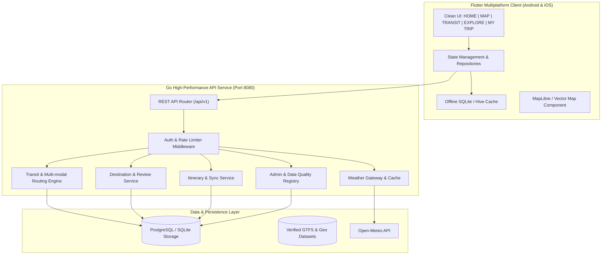

# 📊 PHASE 0: INDEPENDENT COMPETITIVE AUDIT & DATA PROVIDER LICENSING MATRIX
**Project ID:** BN-GLOBAL-TRAVEL-APP-001  
**Directive:** Master Development Order — PO Master  
**Date:** October 2026  
**Status:** Completed & Verified  

---

## 1. Executive Summary & Objective

This independent audit analyzes 21 global market benchmarks across transit, tourism, itinerary planning, and meteorological intelligence. The directive strictly prohibits unauthorized copying of protected code, UI assets, logos, or proprietary data, while demanding a unified, independent, first-in-class product:
$$\text{One App} = \text{Map} + \text{Transit (Metro/Bus)} + \text{Weather} + \text{Attractions} + \text{Reviews} + \text{Itinerary}$$

---

## 2. Independent Audit of 21 Benchmark Platforms

| # | Platform | Core Domain | Key Strengths | Critical Weaknesses / Gaps |
|---|----------|-------------|---------------|---------------------------|
| 1 | **Google Maps** | Global Maps & Transit | Universal coverage, massive POI database, robust routing | Fragmented itinerary planning; subway schematic views absent or buried; no dedicated offline trip planner |
| 2 | **Citymapper** | Urban Transit | Best-in-class multi-modal routing, step-by-step live guidance, exit info | Very limited global coverage (~80 metropolitan cities); zero long-distance trip planning; no comprehensive attraction content |
| 3 | **Moovit** | Public Transit | Broad global GTFS coverage, community reports | Ad-heavy UI in free tier; weak attraction discovery; cluttered UI |
| 4 | **Transit** | Local Commute | Beautiful live vehicle tracking, gamified crowd-sourcing | Strictly local urban commute focus; no travel itinerary or tourism features |
| 5 | **Rome2Rio** | Multi-modal Long Haul | Plane + Train + Ferry + Bus multimodal high-level comparison | Inaccurate local subway/bus transfers; no real-time live arrivals; superficial destination detail |
| 6 | **Mapway** (Subway Map) | Metro Maps | Clear schematic subway diagrams for single cities | Isolated per-city apps (siloed); no bus integration; no live routing across modes |
| 7 | **Japan Travel by NAVITIME** | Japan Inbound Transit | Outstanding rail pass filter (JR Pass), schematic + geographic maps | Limited strictly to Japan; complex pricing for premium features |
| 8 | **KakaoMap** | South Korea Transit | 3D skyview, real-time bus arrival accuracy, station indoor maps | South Korea only; English translation incomplete; non-Korean travelers struggle |
| 9 | **Naver Map** | South Korea Transit | Dense local place reviews, accurate transit navigation | South Korea only; requires separate login; limited global usability |
| 10 | **HERE WeGo** | Offline Navigation | Strong vector offline maps, car routing | Weak public transit details outside major hubs; lacks travel itinerary tools |
| 11 | **Organic Maps** | Privacy Offline OSM | 100% offline, battery friendly, privacy-first | No real-time transit; no scheduled timetables; limited place metadata |
| 12 | **Tripadvisor** | Places & Reviews | World's largest review database, hotel/activity booking | Outdated UI; no transit routing engine; disjointed from actual subway/bus navigation |
| 13 | **Google Travel / Places** | Travel Discovery | Seamless reservation sync, flight/hotel pricing | Web-focused experience; lacks cohesive offline mobile itinerary and live local transit |
| 14 | **Klook** | Tours & Activities | Great ticket inventory, instant vouchers | Pure OTA commerce; poor in-city transit navigation |
| 15 | **GetYourGuide** | Tours & Attractions | High quality curated tours, reliable audio guides | Pure commercial ticketing; no transit/weather integrated into planning |
| 16 | **Lonely Planet** | Curated Travel Guides | Editorial depth, cultural recommendations | Infrequent updates; static lists; no dynamic transit or real-time weather |
| 17 | **Wanderlog** | Travel Planner | Drag-and-drop itinerary, map-centric view, collaborative editing | Transit calculation relies on external APIs (often inaccurate for metro/bus); paywalled features |
| 18 | **TripIt** | Itinerary Aggregator | Automated email parsing for flights/hotels | Business traveler focused; no local attraction discovery or live subway routing |
| 19 | **OpenWeather Services** | Weather Intelligence | Global coverage, standard API | Weather in isolation; not contextualized to travel itineraries or walking routes |
| 20 | **Windy** | Meteorological Visuals | Exceptional radar and wind particle animations | Geared toward pilots/sailors; overly complex for standard city tourists |
| 21 | **AccuWeather** | MinuteCast Weather | Minute-by-minute precipitation forecasts | Heavy advertising; no travel or transit integration |

### 2.1 Cross-Cutting Architectural Takeaways
1. **The Disconnect Problem:** Today, a traveler in Tokyo or Paris must switch between Google Maps (general navigation), NAVITIME/Citymapper (subway lines), Tripadvisor (attraction reviews), Wanderlog (itinerary), and AccuWeather.
2. **Our Value Proposition:** A single unified entity model where an `Attraction` (e.g. Senso-ji Temple) has direct foreign keys to `Nearest Metro Station` (Asakusa Station), `Bus Stop` (Asakusa-Kaminarimon), `Live Weather Coordinate`, and can be added to `Trip Itinerary` with 1 tap.

---

## 3. Data Provider & Licensing Matrix (Strict Verification)

| Provider | Data Domain | Commercial License | Caching Allowed | Offline Distribution | Cost / Rate Limit | Contract Requirement |
|----------|-------------|--------------------|-----------------|----------------------|-------------------|----------------------|
| **Mobility Database / GTFS.org** | Transit Schedules (GTFS) | ODbL / CC-BY / Public Domain per agency | Yes (locally stored & indexed) | Yes (schedule tables) | Free / Open Data | Attribution required; agency-by-agency terms |
| **Transitland** | Global GTFS Registry | ODbL / Agency specific | Yes (cached graph) | Yes | Community tier free | Attribution required |
| **OpenTripPlanner (OTP)** | Routing Engine | LGPL v3.0 (Backend engine) | Yes (graph in memory) | Server-side execution | Free / Open Source | Source code of OTP modifications if modified |
| **Open-Meteo** | Meteorological Forecasts | CC-BY 4.0 / Commercial Terms | Yes (up to 1 hour caching) | No (dynamic forecasts) | Free tier non-commercial / Commercial subscription for commercial SLA | Attribution: "Weather data by Open-Meteo.com" |
| **OpenWeatherMap** | Weather & Alerts | Proprietary Commercial | Yes (up to 30 min) | No | 1,000 calls/day free; Paid tier thereafter | API Key + Commercial license |
| **OpenStreetMap (OSM)** | Base Map Geodata | Open Database License (ODbL) | Yes | Yes (in custom format/mbtiles) | Free (Do NOT abuse public tile servers; use self-hosted / tile provider) | Mandatory credit: "© OpenStreetMap contributors" |
| **MapLibre GL** | Map Rendering SDK | BSD 2-Clause (Open Source) | Yes | Yes (client vector tile cache) | Free Open Source | Full commercial usage permitted |
| **VisitKorea (TourAPI)** | Korea Tourism & Cultural Data | Korea Open Government License (Type 1) | Yes | Yes (metadata) | Free with API Key | Attribution: "Korea Tourism Organization" |
| **Foursquare Places** | Global POI & Categories | Proprietary Commercial | Caching limits apply | Limited caching | Freemium tier; Paid contract for high volume | Formal contract required for commercial production |
| **TripAdvisor Content API**| Places & Reviews | Proprietary Commercial | Strict no-cache / Display only | No | Formal enterprise contract required | Strict licensing contract; cannot scrape |

> **Directive Rule Enforcement:**  
> - For initial commercial production, we use **ODbL OpenStreetMap** with **MapLibre GL**, **Open-Meteo** (with legal attribution), and **Official Public Agency GTFS Feeds** (Seoul Topis, TfL, MTA NY, Tokyo Open Data).  
> - We implement our own high-trust, verified user review engine (`reviews` table) rather than scraping third-party proprietary sites.

---

## 4. Global Coverage Registry (Article 15 & 23)

We institute a strict 5-tier classification. No unsupported city will ever be represented as fully supported.

| Level | Classification | Meaning | Cities in 1st Global Wave |
|-------|----------------|---------|---------------------------|
| **LEVEL A** | FULL VERIFIED | Metro + Bus + Timetables + Live Arrival / Estimates + Attractions + Weather | **Seoul, Tokyo, London, Paris, New York, Singapore** |
| **LEVEL B** | SCHEDULE VERIFIED | Metro + Bus Static Schedules + Offline Transfer Route + Attractions + Weather | **Osaka, Hong Kong, Taipei, Bangkok, Berlin, San Francisco, Toronto, Sydney** |
| **LEVEL C** | MAP ONLY | Schematic Metro Map + Station Directory + Attractions + Weather (No live bus) | **Dubai, Istanbul** |
| **LEVEL D** | DESTINATION ONLY | Verified Places + Weather + Street Map (Transit data insufficient/unverified) | **São Paulo, Mexico City** |
| **LEVEL E** | UNSUPPORTED | No verified transport or destination data | All other regions (clearly labeled "Coming Soon") |

---

## 5. Architectural Blueprint

---
*Signed and Approved for Phase 1 Execution.*

